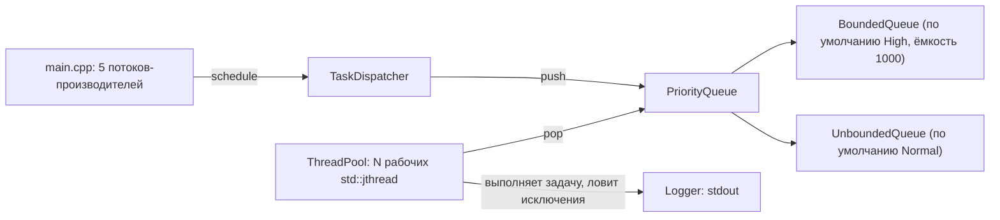

# Диспетчер задач с приоритетами (CppMiddleProject6)

Библиотека на C++23 и демонстрационная программа: задачи (`std::function<void()>`) ставятся в очередь с приоритетом `High` или `Normal`, а пул рабочих потоков выполняет их, начиная с очереди более высокого приоритета. Репозиторий создан из шаблона практического задания «Система диспетчеризации задач с приоритетами» 6-го спринта курса «Мидл разработчик С++» (`README.md:9`). Кто, кроме автора, пользуется кодом, в файлах не сказано.

Формальная спецификация: [../SPEC.md](../SPEC.md).

## Состояние

- Последний коммит собственного кода: `fddc7b5`, 2025-08-15 («add memory_order», `git log`). Все 7 коммитов ветки `dev` сделаны с 2025-08-10 по 2025-08-15.
- Тесты есть: 12 тестов GoogleTest в двух исполняемых файлах, `dispatcher_test` и `queue_test` (`tests/CMakeLists.txt:1`, `tests/queue/CMakeLists.txt:1`). При подготовке этого документа они не собирались и не запускались, результат прогона неизвестен.
- CI в этой ветке нет: ни `.github/workflows`, ни `.gitea/workflows` в `git ls-files` не входят.
- Ветки `origin/test` и `origin/release` содержат более позднюю, отличающуюся версию: от `dev` отличаются 56 файлов в `release` и 57 в `test`, включая заголовки, исходники, тесты, `CMakeLists.txt` и англоязычный `README.md`; там же добавлена оснастка repo-quality-template (в `release` влита merge-коммитом `6b48495`: «bring cpp-middle-project6 to revision 4.0.0»). Ветка `origin/main` тоже отошла от `dev` (общий предок `d578e30`) и содержит коммиты от 2026-08-10 с CI GitHub Actions и сборкой под Windows (MSVC). `origin/HEAD` указывает на `origin/release`. `dev` не является предком `release` (`git merge-base --is-ancestor`). Этот документ описывает только `dev` на `fddc7b5`.
- Признаки незавершённости: `CMakeLists.txt:10-14` ставит `core.hooksPath` на каталог `.githooks`, которого в репозитории нет; `.vscode/launch.json:14` ссылается на задачу `GCC: Build Debug app`, но `tasks.json` в репозитории нет; поле `not_empty_cv_` в обеих очередях получает `notify_one`, но никто его не ждёт (`src/queue/bounded_queue.cpp:11`, `src/queue/unbounded_queue.cpp:8`).

## Структура

| Путь | Содержимое |
|---|---|
| `include/types.hpp` | `enum class TaskPriority { High, Normal }` |
| `include/queue/queue.hpp` | тип `Task`, структура `QueueOptions`, интерфейс `IQueue` |
| `include/queue/bounded_queue.hpp`, `src/queue/bounded_queue.cpp` | очередь с ограниченной ёмкостью, `push` блокируется при заполнении |
| `include/queue/unbounded_queue.hpp`, `src/queue/unbounded_queue.cpp` | очередь без ограничения размера |
| `include/queue/priority_queue.hpp`, `src/queue/priority_queue.cpp` | набор подочередей по приоритетам, блокирующий `pop`, `shutdown` |
| `include/thread_pool/thread_pool.hpp`, `src/thread_pool/thread_pool.cpp` | пул `std::jthread`, цикл выполнения задач |
| `include/task_dispatcher.hpp`, `src/task_dispatcher.cpp` | `TaskDispatcher`: очередь + пул, метод `schedule` |
| `include/logger.hpp` | синглтон `Logger`, пишет строки в `stdout` без буферизации |
| `main.cpp` | демонстрация: 5 потоков ставят по 10 пар задач `Normal`/`High` |
| `tests/` | тесты GoogleTest: `tests/queue/*.cpp` и `tests/task_dispatcher.cpp` |
| `CMakeLists.txt`, `src/**/CMakeLists.txt`, `tests/**/CMakeLists.txt` | сборка CMake |
| `conanfile.py` | зависимость `gtest/1.16.0` для Conan |
| `.devcontainer/` | образ dev-контейнера (Ubuntu, GCC 15) и профиль Conan `default` |
| `.vscode/`, `.clang-format` | настройки редактора, отладчика и форматирования |

## Архитектура

Библиотеки CMake: `queue` (три очереди), `thread_pool`, `task_dispatcher` (связывает обе публично) и исполняемый файл `dispatcher` из `main.cpp` (`src/CMakeLists.txt:4-12`, `CMakeLists.txt:22-32`).



Поток данных:

1. `TaskDispatcher::schedule` передаёт задачу в `PriorityQueue::push` (`src/task_dispatcher.cpp:13-15`).
2. `PriorityQueue` держит `std::flat_map<TaskPriority, std::unique_ptr<IQueue>>`; для каждого приоритета из настроек создаётся `BoundedQueue` (ёмкость из `capacity`, иначе 1024) или `UnboundedQueue` (`src/queue/priority_queue.cpp:9-18`).
3. Рабочий поток вызывает `PriorityQueue::pop`, который обходит подочереди в порядке ключей (`High` < `Normal`, `include/types.hpp:7`) и берёт первую задачу; если все пусты, ждёт на `condition_variable` (`src/queue/priority_queue.cpp:35-51`).
4. Исключение задачи перехватывается и записывается через `Logger` (`src/thread_pool/thread_pool.cpp:21-27`).
5. Деструктор `ThreadPool` вызывает `shutdown`; рабочие доделывают оставшиеся задачи и завершаются, `std::jthread` присоединяются при уничтожении вектора (`src/thread_pool/thread_pool.cpp:17`, `src/queue/priority_queue.cpp:45-47`).

Внешних сервисов, сети, файлов и оборудования код не использует.

## Сборка и запуск

Требования из файлов проекта:

- CMake ≥ 3.25 (`CMakeLists.txt:1`), стандарт C++23 без расширений (`CMakeLists.txt:4-6`).
- Компилятор со стандартной библиотекой, где есть `<flat_map>` и `<print>` (`include/queue/priority_queue.hpp:7`, `main.cpp:4`). Dev-контейнер ставит `g++-15`/`gcc-15` и делает их компилятором по умолчанию (`.devcontainer/Dockerfile:5-9`).
- GoogleTest нужен уже на этапе конфигурации, даже для сборки одной программы (`find_package(GTest REQUIRED)`, `CMakeLists.txt:16`). В контейнере он ставится пакетом `libgtest-dev` (`.devcontainer/Dockerfile:5`); `conanfile.py:13` объявляет `gtest/1.16.0`, но команды `conan install` в файлах проекта нет.

Окружение: открыть проект в VS Code и выполнить `Dev Containers: Reopen in Container` (`README.md:17-18`).

Сборка (`README.md:29-37`):

```bash
mkdir build ; cd build
cmake ..
make -j4
```

Исполняемый файл программы — `build/dispatcher` (цель `dispatcher`, `CMakeLists.txt:22-24`; этот путь запускает отладочная конфигурация `.vscode/launch.json:11`). Отдельной команды запуска в файлах проекта нет.

Побочный эффект конфигурации: `cmake ..` выполняет `git config core.hooksPath .githooks` в каталоге исходников (`CMakeLists.txt:10-14`).

## Конфигурация

Переменных окружения, конфигурационных файлов времени выполнения и флагов командной строки у программы нет: `main()` не принимает аргументов (`main.cpp:12`). Настройка делается аргументами конструктора:

| Параметр | Где | Смысл | Значение по умолчанию |
|---|---|---|---|
| `thread_count` | `TaskDispatcher` (`include/task_dispatcher.hpp:16`) | число рабочих потоков | нет; `main.cpp:13` передаёт `std::thread::hardware_concurrency()` |
| `tasks_options` | `TaskDispatcher` (`include/task_dispatcher.hpp:17-19`) | подочередь для каждого приоритета | `High`: ограниченная, 1000; `Normal`: неограниченная |
| `QueueOptions::bounded` | `include/queue/queue.hpp:10` | ограниченная (`true`) или нет | — |
| `QueueOptions::capacity` | `include/queue/queue.hpp:11` | ёмкость ограниченной очереди | 1024, если не задана (`src/queue/priority_queue.cpp:13`) |

Настройки сборки и инструментов: профиль Conan `.devcontainer/default` (gcc 15, `compiler.cppstd=23`, `build_type=Release`, Linux x86_64); `.vscode/settings.json:6` ищет `compile_commands.json` в `build/Release/`; стиль кода — `.clang-format` (LLVM, ширина 120, отступ 4).

## Использование

Встраивание в свой код (по сигнатурам `include/task_dispatcher.hpp:16-21`):

```cpp
#include "task_dispatcher.hpp"

dispatcher::TaskDispatcher td(4);  // High: ограниченная на 1000, Normal: неограниченная
td.schedule(dispatcher::TaskPriority::High, [] { /* работа */ });
td.schedule(dispatcher::TaskPriority::Normal, [] { /* работа */ });
// деструктор td выполняет оставшиеся задачи и останавливает потоки
```

Демонстрация `dispatcher` (`main.cpp:16-25`): 5 потоков, каждый 10 раз ставит задачу `Normal` и задачу `High`; задачи печатают строки `Normal priority message №N` и `High priority message №N`, где `N = 10*i + j` (0–49). Порядок строк зависит от планирования потоков.

## Тестирование

Запуск после сборки (`README.md:41-44`):

```bash
cd build
ctest --verbose
```

`ctest` запускает два исполняемых файла (`tests/CMakeLists.txt:14`, `tests/queue/CMakeLists.txt:16`):

| Набор | Тесты | Что проверяют |
|---|---|---|
| `BoundedQueueTest` | `PushAndPop`, `RespectsCapacity`, `MultiThreaded` | добавление/извлечение, ожидание свободного места (сам факт блокировки `push` тест не утверждает), 2 производителя и 2 потребителя |
| `UnboundedQueueTest` | `PushAndPop`, `HandlesManyItems`, `MultiThreaded` | 10000 элементов, 4 производителя и 4 потребителя |
| `PriorityQueueTest` | `HighPriorityFirst`, `PopBlocksOnEmpty`, `Shutdown`, `ShutdownDrainsTasks` | порядок приоритетов, блокировка `pop`, остановка и выдача остатка |
| `TaskDispatcherTest` | `ExecutesTasks`, `HighPriorityTasksFirst` | выполнение всех 20 задач, порядок `High` перед `Normal` при 2 потоках |

Не покрыты тестами: `Logger`, перехват исключений в `ThreadPool`, отбрасывание задачи с приоритетом без подочереди, ёмкость 1024 по умолчанию, `main.cpp`.

## Известные ограничения и проблемы

Пункты с пометкой «вывод» получены чтением кода; они не воспроизводились.

- Вывод: возможна взаимная блокировка при заполненной ограниченной подочереди. `PriorityQueue::push` держит `mutex_` очереди приоритетов, пока `BoundedQueue::push` ждёт свободного места (`src/queue/priority_queue.cpp:22-24`, `src/queue/bounded_queue.cpp:9`), а рабочим для извлечения нужен тот же `mutex_` (`src/queue/priority_queue.cpp:36`). В `origin/release` `PriorityQueue::push` устроен так же.
- Вывод: возможна потеря пробуждения при остановке. `shutdown` меняет флаг и вызывает `notify_all` без захвата `mutex_` (`src/queue/priority_queue.cpp:30-33`); если это произойдёт между проверкой флага и `cv_.wait` (`src/queue/priority_queue.cpp:45-49`), рабочий поток не проснётся и деструктор `ThreadPool` не дождётся его. В `origin/release` это исправлено коммитом `a7a4618` (2026-11-07): `shutdown` ставит флаг под `mutex_`, с комментарием именно об этой гонке.
- Вывод: тест `TaskDispatcherTest.HighPriorityTasksFirst` зависит от планирования: задачи `Normal` ставятся первыми при уже запущенных двух рабочих потоках (`tests/task_dispatcher.cpp:56-70`), и ничто не мешает выполнить их до постановки задач `High`. В ветке `main` тест той же схемы (5 задач `Normal` первыми, 2 рабочих) по сообщению коммита `a28620b` (2026-08-10) упал в CI на первом элементе; версия `dev` не запускалась.
- Задача с приоритетом, для которого нет подочереди, молча отбрасывается (`src/queue/priority_queue.cpp:23-25`).
- `QueueOptions::capacity` имеет тип `std::optional<int>`, а `BoundedQueue` принимает `unsigned` (`include/queue/queue.hpp:11`, `include/queue/bounded_queue.hpp:17`); проверки значения нет. При ёмкости 0 `push` будет ждать бесконечно (вывод из предиката `src/queue/bounded_queue.cpp:9`).
- Если `std::thread::hardware_concurrency()` вернёт 0 (стандарт это допускает), `main.cpp:13` создаст пул без потоков, и задачи не выполнятся.
- У диспетчера нет способа дождаться выполнения задач, кроме уничтожения объекта, и нет отмены задач (`include/task_dispatcher.hpp:11-23`).
- `Task` — `std::function<void()>`, поэтому некопируемые вызываемые объекты поставить нельзя (`include/queue/queue.hpp:7`).
- `Logger::Log` не берёт мьютекс; целостность строк при одновременной записи зависит от `fprintf` стандартной библиотеки (`include/logger.hpp:15`).
- Каталог `.githooks` и задача VS Code `GCC: Build Debug app` отсутствуют (см. «Состояние»).

## Связанные документы

- [../SPEC.md](../SPEC.md) — спецификация требований.
- [../README.md](../README.md) — исходный README шаблона: начало работы, сборка, тесты.
- [../LICENSE](../LICENSE) — лицензия MIT.

## Об этом документе

Написан 2026-11-18 по коммиту `fddc7b5` (ветка `dev`). Для проверки выполнены только команды чтения: `git ls-files`, `git log`, `git branch -a`, `git show --stat`, `git diff --stat origin/dev origin/release`, `git merge-base --is-ancestor origin/dev origin/release`, `which cmake g++ clang++ conan ctest`. Не выполнялись: `cmake`, `make`, `ctest`, запуск `build/dispatcher`, `conan install` — на машине, где писался документ, `g++` в `PATH` нет, а сборка в задачу не входила. Поэтому утверждения о поведении взяты из исходного кода, а не из прогона.
